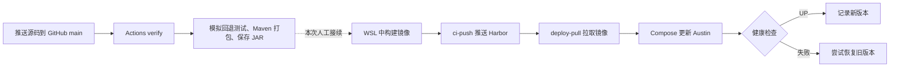

# Austin CI/CD 本次操作记录与复现步骤

这份记录对应 GitHub 仓库 `hxy123-google/ci-cd` 的[首次 Actions 运行](https://github.com/hxy123-google/ci-cd/actions/runs/38437309267)，源代码提交为 `1e733713eae8bb6b42841849f2aebe167c14d364`。本次实现的是 **GitHub 自动 CI + WSL 手动发布、部署**。GitHub 上的 `publish`、`deploy` 作业没有执行；本机 Harbor 推送和 Compose 部署由人工完成。

## 一、先理解每个组件

| 组件 | 在这次演练中的作用 |
| --- | --- |
| GitHub 仓库 | 保存源码和流水线配置；`push` 触发 Actions。 |
| GitHub Actions | 根据 `.github/workflows/ci.yml` 执行作业，展示每一步的日志与结果。 |
| GitHub 托管 Runner | GitHub 提供的临时 Ubuntu 执行环境，运行本次 `verify` 作业。 |
| Maven / JAR | 把多模块 Java 项目编译、打包；JAR 是应用程序文件。 |
| Docker 镜像 | 将 Java 运行环境与 JAR 装入可部署的版本；镜像标签使用完整提交 SHA。 |
| Harbor | 本机 WSL 中的私有镜像仓库，保存可部署和可回退的镜像。 |
| Robot Account | `ci-push` 有推送权限，`deploy-pull` 只有拉取权限；凭据保存在 WSL 用户目录。 |
| Docker Compose | 在 WSL 中管理 MySQL、Redis、Austin 三个服务及数据卷。 |
| 健康检查 | 部署后访问 `/actuator/health`；新版本不健康时，部署脚本尝试恢复旧镜像。 |



## 二、GitHub 上实际发生了什么

1. 我们从独立工作区提交并推送项目快照到你的 `main`。原工作区 `D:\桌面\花海java\austin\austin` 中大量包名迁移等未提交修改没有进入这次提交。GitHub 曾拒绝推送上游旧历史中的疑似密钥，因此公开仓库使用了只包含当前项目快照的全新根提交；这也是 GitHub 上目前只看到一个提交的原因。不要把原工作区的旧 Git 历史直接推到此公开仓库。
2. `push` 命中 [CI 工作流](../.github/workflows/ci.yml) 的触发条件。`verify` 在 `ubuntu-latest` 上检出代码，并配置 Temurin Java 8 和 Maven 依赖缓存。
3. 执行 `bash deploy/test-deploy.sh`。它用模拟的 `docker`、`curl` 和 `sleep` 命令验证部署脚本在健康检查失败时会恢复上一版本；**这一步没有操作真实 Harbor 或真实容器**。
4. 执行 `mvn -B -ntp -pl austin-web -am package -DskipTests`。`-pl austin-web -am` 表示构建 Web 模块和它需要的项目模块；`-DskipTests` 表示本轮跳过 Java 测试。现有 Java 测试需要额外服务，尚未纳入这条 CI。
5. 将 `austin-web/target/austin-web-0.0.1-SNAPSHOT.jar` 上传为名为 `austin-web-jar` 的 Actions artifact，保留 7 天。artifact 是可供下载或后续作业使用的**构建文件**，不是 Docker 镜像。
6. 本次 `verify` 为成功；`publish` 因未配置 `HARBOR_REGISTRY`、`HARBOR_PROJECT` 而跳过，`deploy` 也未启用。工作流中的发布与部署作业要求带 `austin-lab` 标签的 Linux 自托管 Runner；当前公开仓库没有接入该 Runner。

在 GitHub 打开本页开头的运行链接，依次点击 `verify`，展开 `Set up job`、`Simulate deployment and automatic rollback`、`Package the web application`、`Upload artifact`，即可把上述步骤与日志逐一对应。

## 三、WSL 中如何复现手动发布与部署

以下命令以本次隔离工作区为例。**Windows PowerShell** 和 **WSL Bash** 的提示分开写；不要在有大量未提交修改的原工作区直接打包、提交或推送。Harbor、`demo` 项目、Robot Account 和 `~/austin-cicd/.env` 在本次演练中已经准备好。首次安装步骤见 [完整搭建手册](CICD.md)。

### 1. 在 Windows PowerShell 确认源码并打包

```powershell
Set-Location 'C:\Users\huixinyuan\.codex\worktrees\ci-cd-lab\austin'
git status --short
git rev-parse HEAD
mvn -B -ntp -pl austin-web -am clean package -DskipTests
```

本次 `git rev-parse HEAD` 应显示 `1e733713eae8bb6b42841849f2aebe167c14d364`，Maven 应出现 `BUILD SUCCESS`，并生成 `austin-web/target/austin-web-0.0.1-SNAPSHOT.jar`。这是本机重新打包；**没有从 GitHub 下载上一步的 artifact**。

### 2. 在 WSL 检查 Harbor 并构建镜像

```bash
cd /mnt/c/Users/huixinyuan/.codex/worktrees/ci-cd-lab/austin
curl -fsS https://harbor.local:8443/api/v2.0/health
image=harbor.local:8443/demo/austin:sha-1e733713eae8bb6b42841849f2aebe167c14d364
docker build --pull -t "$image" .
```

通常由项目根目录的 [Dockerfile](../Dockerfile) 使用 `eclipse-temurin:8-jre` 基础镜像，把 JAR 复制到 `/app/austin.jar`。如果上述 `docker build` 成功，就直接进入下一步。**本次**拉取 Docker Hub 基础镜像时超时，所以实际改用本机已有的 `austin-cicd:local` 镜像作为运行底座，再覆盖新 JAR：

```bash
docker image inspect austin-cicd:local >/dev/null
docker build --pull=false -t "$image" -f - . <<'DOCKERFILE'
FROM austin-cicd:local
COPY austin-web/target/austin-web-0.0.1-SNAPSHOT.jar /app/austin.jar
DOCKERFILE
```

这一段只是网络故障时的本机实验方式；它不能证明从仓库 Dockerfile 开始的全新镜像构建已经通过。本次镜像包含上述提交对应的新 JAR。

### 3. 用推送账号把镜像放进 Harbor

```bash
robot_file="$HOME/austin-harbor/robots/ci-push.json"
robot_name=$(python3 -c 'import json,sys; print(json.load(open(sys.argv[1]))["name"])' "$robot_file")
python3 -c 'import json,sys; print(json.load(open(sys.argv[1]))["secret"])' "$robot_file" \
  | docker login harbor.local:8443 --username "$robot_name" --password-stdin
docker push "$image"
docker logout harbor.local:8443
unset robot_file robot_name
```

随后用浏览器打开 `https://127.0.0.1:8443`，在 Harbor 的 `demo → austin` 查看 `sha-1e733713...` 标签。`127.0.0.1` 用于 Windows 浏览器访问；WSL 内的 Docker 使用证书匹配的 `harbor.local:8443`。本次推送的镜像 digest 为 `sha256:af38c978bee9111ab0a071a238b6cdcec293c0e9c4173cf2b286304911ced034`。

### 4. 用拉取账号部署

```bash
bash deploy/prepare-local-app-wsl.sh
robot_file="$HOME/austin-harbor/robots/deploy-pull.json"
robot_name=$(python3 -c 'import json,sys; print(json.load(open(sys.argv[1]))["name"])' "$robot_file")
python3 -c 'import json,sys; print(json.load(open(sys.argv[1]))["secret"])' "$robot_file" \
  | docker login harbor.local:8443 --username "$robot_name" --password-stdin
bash "$HOME/austin-cicd/deploy.sh" "$image"
docker logout harbor.local:8443
unset robot_file robot_name
```

`prepare-local-app-wsl.sh` 把 Compose、部署脚本和数据库初始化 SQL 放到 `~/austin-cicd`，已有 `.env` 会保留。`deploy.sh` 的顺序是：记住旧镜像 → 确保 MySQL、Redis 运行 → 从 Harbor 拉新镜像 → 更新 Austin 容器 → 等待健康检查。Austin 使用 `cicd` 配置，连接 Compose 服务名 `mysql`、`redis`，对本机开放 `127.0.0.1:7777`。成功后才写入 `current-image`；本次健康检查返回 `UP`。

### 5. 验证部署结果

```bash
cd "$HOME/austin-cicd"
docker compose -f compose.yml ps
cat current-image
curl -fsS http://127.0.0.1:7777/actuator/health
```

本次 `current-image` 应为上述 `demo/austin:sha-1e733713...`，健康响应顶层应为 `"status":"UP"`。浏览器也可访问 `http://127.0.0.1:7777/actuator/health`。

## 四、回退如何做、如何验证

部署脚本读取 `~/austin-cicd/current-image` 作为旧版本。若新版本启动失败或 `/actuator/health` 始终未返回 `UP`，脚本会尝试用旧镜像重新创建 Austin 容器，并再次检查健康状态。新版本成功后，旧标签写入 `previous-image`；`current-image` 只在成功后更新。初次部署若没有旧镜像，就没有可自动恢复的版本。

本次 GitHub CI 中的 `deploy/test-deploy.sh` 验证了**模拟回退**；此前还运行过 [真实 Compose 回退演练](../deploy/exercise-local-rollback-wsl.sh)：在独立的 Harbor `lab-test` 项目中准备一个好镜像和一个故意错误的镜像，部署坏版本后确认应用恢复为好版本。该脚本会切换当前运行的应用；理解它的影响后再重复执行。`sha-111...`、`sha-222...` 是实验标签，不代表 Git 提交。

下次发布**第二个真实版本**后，可把第一个版本的完整镜像地址再次传给 `deploy.sh` 做人工回退；需先用 `deploy-pull` 登录 Harbor：

```bash
bash "$HOME/austin-cicd/deploy.sh" \
  harbor.local:8443/demo/austin:sha-1e733713eae8bb6b42841849f2aebe167c14d364
```

回退后核对 `current-image` 和健康检查。单机 Compose 更新期间可能短暂中断；镜像回退不会还原数据库结构或数据。

## 五、之后怎样变成自动 CD

工作流已留好 [publish 作业](../.github/workflows/ci.yml) 和 [部署工作流](../.github/workflows/deploy.yml)。将来若接入能够访问本机 Harbor、Docker 的 `austin-lab` 自托管 Runner，配置 `HARBOR_REGISTRY`、`HARBOR_PROJECT` 与相应 Robot Account Secrets 后，默认分支 `push` 才会自动从 CI artifact 构建并推送镜像；再启用 `DEPLOY_ENABLED=true`，才会自动部署。手动触发部署工作流并输入旧的 `sha-<完整 40 位提交号>`，则是预留的人工回退入口。当前这些作业均未运行。

本仓库保持公开，因此暂未把个人 WSL 注册为自托管 Runner。[GitHub 官方建议自托管 Runner 用于私有仓库](https://docs.github.com/en/actions/how-tos/manage-runners/self-hosted-runners/add-runners)，因为公开仓库的 PR 可能让不可信代码在本机执行。

## 六、面试时可以这样讲

> 我给 Austin 增加了 GitHub Actions CI：提交触发 Java 8 环境下的 Maven 打包和部署回退脚本验证，并保存 JAR artifact。我在 WSL 搭建 Harbor，用不同权限的 Robot Account 完成镜像推送和拉取，再用 Docker Compose 部署应用，通过 Actuator 健康检查判定发布成功；如果新版本不健康，部署脚本会尝试恢复旧镜像。我还用故意损坏的镜像验证过真实回退。当前公开仓库只自动执行 CI，Harbor 发布和 Compose 部署由我手动完成，尚未接入自动 CD。Java 单元测试在这轮被跳过，数据库也不在镜像回退范围内。
